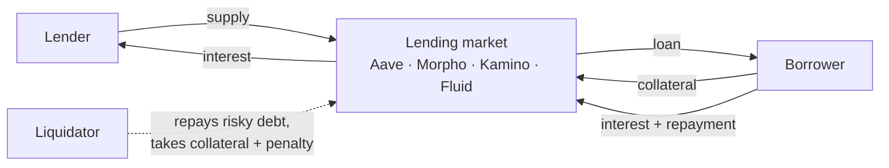

<p align="center">
  
</p>

# DYXY Lend

How DYXY Lend connects users to Aave, Morpho, Kamino and Fluid: supply assets to earn interest, or deposit collateral and borrow against it, with every market compared in one place.

> This repository describes how the product works. It does not contain DYXY source code. User guide: [docs.dyxy.io/earn/lend](https://docs.dyxy.io/earn/lend/overview).

## Overview



Funds go directly into the protocol's contracts. DYXY charges no fee on lending.

## Two tabs

| Tab | What the user does |
| --- | --- |
| **Earn Interest** | Supply an asset and earn a variable supply APY paid by borrowers |
| **Collateral Loans** | Deposit collateral and borrow another asset against it |

## Market data

| Field | Meaning |
| --- | --- |
| Supply APY | Current yearly rate for lenders |
| Borrow APY | Current yearly rate for borrowers |
| Total supplied | Deposits in the market |
| Available | Liquidity that can be borrowed or withdrawn now |
| Max LTV | Highest loan-to-value allowed when borrowing |
| Liquidation threshold | LTV at which a loan can be liquidated (LLTV on Morpho) |

## Interest rates

Rates move with **utilization**, the share of supplied assets that is borrowed.

```
utilization = total borrowed ÷ total supplied
supply APY  ≈ borrow APY × utilization × (1 − reserve factor)
```

As utilization approaches 100%, rates rise sharply, which pulls in new lenders and pushes borrowers to repay.

## Documents

| Document | Contents |
| --- | --- |
| [Supply and borrow](docs/supply-and-borrow.md) | Flows, interest accrual, worked examples |
| [Health factor](docs/health-factor.md) | Formula, what moves it, liquidation |
| [Protocols](docs/protocols.md) | How Aave, Morpho, Kamino and Fluid differ |

## License

Text and diagrams in this repository are licensed under [CC BY 4.0](LICENSE). The DYXY name and logo are not covered by this license.
