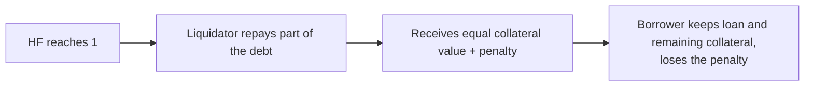

# Health factor

```
health factor = (collateral value × liquidation threshold) ÷ debt value
```

| Health factor | Status |
| --- | --- |
| Above 2 | Comfortable |
| 1.5 to 2 | Moderate |
| 1.1 to 1.5 | At risk |
| 1 or below | Liquidatable |

## Example

$20,000 ETH collateral · threshold 85% · $10,000 USDC debt

```
HF = 20,000 × 0.85 ÷ 10,000 = 1.70
```

| ETH move | Collateral | Health factor |
| --- | --- | --- |
| 0% | $20,000 | 1.70 |
| −30% | $14,000 | 1.19 |
| ≈ −41% | ≈ $11,765 | 1.00 |

## What moves it

| Lower (riskier) | Higher (safer) |
| --- | --- |
| Collateral price falls | Collateral price rises |
| Borrowed asset price rises | Borrowed asset price falls |
| Interest accrues | Partial repayment |
| More borrowing | More collateral |
| Collateral withdrawn | |

## Liquidation



How much is liquidated at once and the penalty size depend on the protocol and market. Some protocols liquidate only enough to restore a healthy position.
