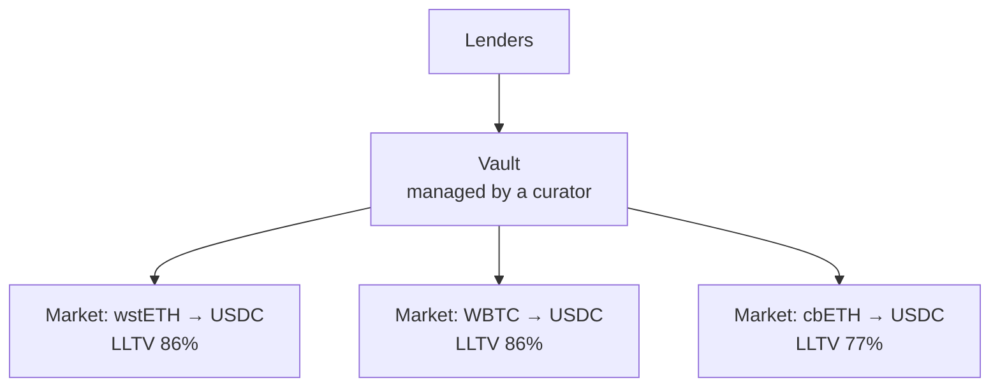

# Protocols

| | Aave | Morpho | Kamino | Fluid |
| --- | --- | --- | --- | --- |
| Design | Shared pools per network | Isolated markets and curated vaults | Lending markets and vaults | Shared liquidity layer with vaults |
| Main networks | Ethereum, major EVM networks | Ethereum, Base, other EVM networks | Solana | Ethereum, major EVM networks |
| Distinctive | Largest and longest-running | Risk isolation per market | Leading lender on Solana | High LTVs, low liquidation penalties |

## Aave

One pool per asset per network. Supplied assets can collateralize borrowing of any other asset in the same market. Each collateral has its own max LTV and liquidation threshold. **E-mode** raises LTVs between correlated assets, such as ETH and ETH liquid staking tokens, or stablecoins.

## Morpho

Each market has exactly one collateral asset, one loan asset, one oracle and one LLTV, so risk cannot spread between markets. Most lenders supply through **vaults**, whose curators allocate liquidity across markets. A position is liquidatable when its LTV exceeds the market's LLTV. The liquidator's bonus depends on the LLTV and is smaller in high-LLTV markets.

*Market examples in the diagram are illustrative.*

## Kamino

The main lending protocol on Solana. Supply SOL, stablecoins and liquid staking tokens such as mSOL, borrow against Solana-native collateral. Low transaction costs make frequent adjustments practical.

## Fluid

A single liquidity layer shared by lending and borrowing.

- **Lending** through Fluid's lending tokens
- **Vaults** with single-collateral borrowing and high LTVs on correlated pairs
- **Smart collateral and smart debt**: in some vaults collateral or debt also acts as DEX liquidity and earns trading fees
- **Liquidations** remove only what is needed to restore the position, with low penalties
