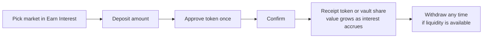
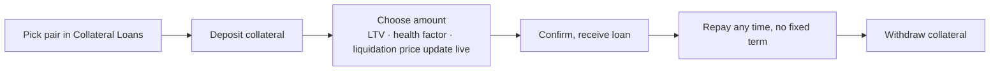

# Supply and borrow

## Supplying

Interest accrues every block. A deposit can only be withdrawn from liquidity that is not currently lent out; at very high utilization, withdrawals may wait until borrowers repay or new lenders supply.

**Example.** 10,000 USDC at 6% supply APY grows to about 10,049 USDC after a month and about 10,600 USDC after a year, if the rate stays the same.

Supplying alone carries no liquidation risk.

## Borrowing

| Term | Formula or meaning |
| --- | --- |
| LTV | debt ÷ collateral value |
| Max LTV | Borrowing limit for the market |
| Liquidation threshold | LTV at which liquidation becomes possible |
| Liquidation price (single collateral, stable debt) | debt ÷ (collateral amount × liquidation threshold) |

## Worked example

5 ETH at $4,000 = $20,000 collateral · max LTV 80% · liquidation threshold 85%

| Borrowed | LTV | ETH liquidation price |
| --- | --- | --- |
| $6,000 | 30% | ≈ $1,412 |
| $10,000 | 50% | ≈ $2,353 |
| $16,000 | 80% | ≈ $3,765 |

Borrowing at the maximum leaves a drop of only about 6% before liquidation.

Debt grows with interest even when prices stay flat, so an untouched loan slowly drifts toward the threshold.
